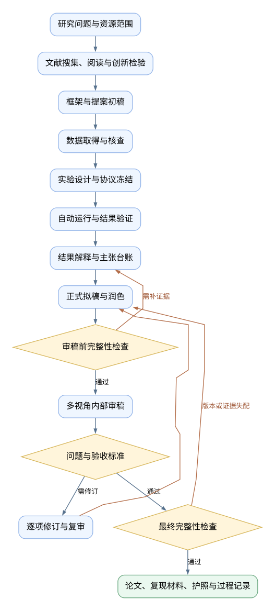

# ML Research & Paper

**An AI agent skill for machine learning research: literature → experiments → evidence → paper → review.**

[English](README.md) · [简体中文](README.zh-CN.md)

[](https://github.com/ZIJIE-XUE/research-to-paper-agent-skill/actions/workflows/tests.yml)
[](skills/ml-research-paper/SKILL.md)
[](examples/quick_demo.py)
[](LICENSE)

Keep the research question, source evidence, experiment outputs and manuscript claims connected across sessions. `ml-research-paper` combines an agent workflow with small local Python tools for bounded experiment queues, provenance checks and resumable checkpoints.

Designed for classification, regression, forecasting, tabular ML, computer vision and NLP studies. Start a new project, resume existing work, or request just a literature review, experiment design, citation check or manuscript review.

**[Try the offline demo](#try-it-without-an-agent-or-api-key) · [Install the skill](#install-the-skill) · [Chinese guide](README.zh-CN.md) · [Report a problem](https://github.com/ZIJIE-XUE/research-to-paper-agent-skill/issues)**

## Why this project?

- **Run experiments, then write results.** Freeze the plan and inputs, execute real local commands, retain failures and connect claims to actual output files.
- **Resume with evidence.** Successful jobs are reused only after output hashes are checked. Changed inputs or protocols require a new experiment ID.
- **Inspect citations at four levels.** The agent checks existence, metadata, source location and whether the source supports the claim; Python checks the registered relationships and files.
- **Revise against explicit issues.** Review findings have stable IDs, evidence locations and acceptance criteria. Pre-review and final integrity reports bind the material versions they checked.
- **Make handoffs explicit.** Record plan-versus-execution differences, negative results and limitations; compare claim wording across revisions. These are agent-reviewed records, not automatic semantic guarantees.
- **Keep research portable.** A material passport, handoff and process record help a new session pick up the same study.

Negative results and replication studies are valid outcomes. The skill does not promise novelty, scientific truth or paper acceptance. Human authors remain responsible for their research.

## Try it without an agent or API key

Only Git and Python 3.10+ are needed. No packages, dataset downloads, GPU or paid model calls:

```bash
git clone https://github.com/ZIJIE-XUE/research-to-paper-agent-skill.git
cd research-to-paper-agent-skill
python examples/quick_demo.py
```

The demo trains a majority baseline and a nearest-centroid classifier on synthetic data, runs four jobs, verifies safe reuse, creates a claim ledger and audits the local execution receipts. Outputs are saved under `work/demo/` and are excluded from Git.

Expected completion message:

```text
4 jobs completed; 4 outputs verified and reused; registered-object audit passed.
```

This demonstrates the tool chain, not scientific discovery or a complete paper. The two ordering seeds are not independent scientific replications. Use a fresh directory to run it again:

```bash
python examples/quick_demo.py --project work/demo-2
```

## Install the skill

Copy `skills/ml-research-paper/` into your agent's skill directory. For a first Codex installation on Windows:

```powershell
# Run from the cloned repository.
$skillParent = Join-Path $env:USERPROFILE '.codex/skills'
$skillTarget = Join-Path $skillParent 'ml-research-paper'
if (Test-Path -LiteralPath $skillTarget) { throw 'Skill already exists; compare and back up local changes first' }
New-Item -ItemType Directory -Path $skillParent -Force | Out-Null
Copy-Item -LiteralPath './skills/ml-research-paper' -Destination $skillTarget -Recurse
```

On macOS/Linux, for the same first-time directory installation:

```bash
mkdir -p ~/.codex/skills
# Confirm this destination does not already exist before copying.
test ! -e ~/.codex/skills/ml-research-paper && cp -R skills/ml-research-paper ~/.codex/skills/
```

Open a new agent conversation in your research project and invoke:

```text
Use $ml-research-paper, mode=pipeline.
Study class imbalance in small tabular datasets. Inspect my existing materials first.
Use legally accessible data and a two-hour experiment budget.
Preserve failed experiments and negative results; report evidence gaps honestly.
```

The full workflow needs a capable agent with research, file and execution tools. The bundled Python helpers do not call model APIs. Other skill-capable hosts can adapt the installation path; host-specific features need their own verification. The user chooses the model.

For updates, run `git pull --ff-only`, compare installed customizations, then sync the skill source. Keep generated study outputs and caches outside the installed skill.

## Research workflow



The diagram's labels are Chinese; the stages are: scope → literature → novelty → framework → data → design → experiments → conclusions → draft → polish → review → final. Revisions return to the earliest affected stage. Loops are bounded by the research budget and review policy.

The agent creates task-specific training and analysis code. The runner executes a frozen queue with per-job timeouts and a cumulative time budget; it does not automatically choose datasets, architectures or hyperparameters. New experiments still need scientific design and validation.

## Use only the stage you need

```text
Use $ml-research-paper, mode=plan: narrow this direction to a testable question.
Use $ml-research-paper, mode=literature: read my existing corpus, then search for gaps.
Use $ml-research-paper, mode=novelty: find the closest prior work and counterexamples.
Use $ml-research-paper, mode=design: define leakage checks, fair baselines and a feasible budget.
Use $ml-research-paper, mode=run: verify the frozen plan and execute it.
Use $ml-research-paper, mode=citation-check: check whether the cited sources support these claims.
Use $ml-research-paper, mode=review, focus=methodology: assess the current methods and experiments.
Use $ml-research-paper, mode=revise: address these reviewer comments with a response ledger.
Use $ml-research-paper, mode=re-review: verify the original findings against the revised paper.
Use $ml-research-paper, mode=resume: verify checkpoints and continue the current project.
```

These are natural-language modes, not registered slash commands. Additional modes cover interpretation, outlines, abstracts, drafting, polishing, integrity, formatting and disclosure. See the [mode reference](skills/ml-research-paper/references/modes.md).

## Tools and evidence boundaries

- [`pipeline.py`](skills/ml-research-paper/scripts/pipeline.py): project initialization, version-bound checkpoints and material-passport export.
- [`run_experiments.py`](skills/ml-research-paper/scripts/run_experiments.py): bounded local execution, logs, frozen inputs, failure receipts and verified reuse.
- [`audit_integrity.py`](skills/ml-research-paper/scripts/audit_integrity.py): structural and provenance checks of registered claims, citations, outputs and review issues.

The agent reads and judges sources; scripts do not prove semantic support, raw-data authenticity, complete claim extraction or scientific correctness. Internal AI review is not independent human peer review. The tools are not an execution sandbox and do not stay active after the host stops.

PRISMA screening, meta-analysis engines, automated scholarly-index resolvers, calibrated acceptance predictions and persistent background services are not bundled. Document rendering, extra model calls and cloud compute depend on tools and user authorization.

## Validation and contributions

```bash
python -m unittest discover -s tests -v
```

The suite covers stale checkpoints, timeouts, budgets, failures, tampered outputs, citation relations and integrity gates. [Validation records](docs/validation.json) state the tested scope and remaining unknowns. The live CI badge links to current runs.

Try the demo, report a minimal failure, improve a task protocol or help translate the docs. See [CONTRIBUTING.md](CONTRIBUTING.md). Feedback with a small public/synthetic example is particularly useful.

## Documentation

- [中文快速指南](docs/quickstart.md)
- [Architecture / 架构](docs/architecture.md)
- [Execution and checkpoint contracts](skills/ml-research-paper/references/automation.md)
- [Integrity and information flow](skills/ml-research-paper/references/integrity.md)
- [Design notes and attribution](docs/design-notes.md)

The research protocols are primarily Chinese; English invocation examples and the offline tools make it easier to evaluate the project while documentation improves.

## Acknowledgments and license

The mode-based interface, evidence handoffs and two integrity checkpoints were informed by reading [ARS](https://github.com/Imbad0202/academic-research-skills) and [ARS-Codex](https://github.com/Imbad0202/academic-research-skills-codex). This is an independent implementation, not an official ARS fork or a port of its complete modules. See the [design notes](docs/design-notes.md) for adopted ideas and boundaries.

[MIT License](LICENSE). The license covers this repository's original code and documentation, not third-party papers or datasets. Private manuscripts, credentials and research data are not included.
