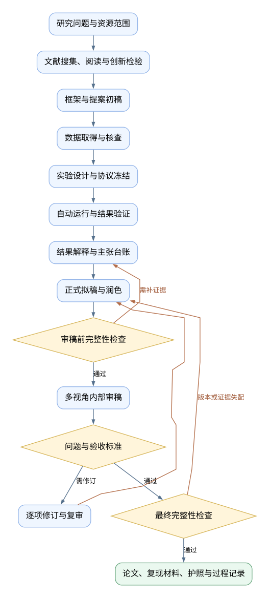

# ML Research & Paper · 机器学习研究及论文生成

[English](README.md) · 简体中文

[](skills/ml-research-paper/SKILL.md)
[](LICENSE)
[](skills/ml-research-paper/scripts)

**把一个机器学习研究问题，推进为有实验依据、可审查、可继续修订的论文。**

`ml-research-paper` 是一条可复用的 AI agent skill，覆盖文献搜集与阅读、创新点检验、研究框架、数据获取、实验设计和自动运行、结果解释、论文起草、润色、审稿与迭代交付。适用于新课题、已有论文/代码/结果的续作，以及指定单阶段任务。

它面向通用机器学习研究，不绑定某篇论文、数据集或应用领域。研究问题、证据和计算预算决定采用什么方法；允许复制扩展、负结果，以及“创新尚未确立”的诚实结论。

> AI agent 负责执行研究工作和保存证据；作者决定研究目标并对最终论断负责。脚本通过表示已登记对象的检查通过，不保证数据真实、学术创新、部署价值或论文录用。

**导航：** [快速开始](#快速开始) · [功能](#功能) · [工作流](#完整工作流) · [模式](#按需调用) · [安装](#安装与更新) · [验证](#验证与能力边界) · [ARS参考](#与-ars-的关系)

## 无需 API Key 的离线试用

先用纯 Python 示例确认工具链可用：

```powershell
git clone https://github.com/ZIJIE-XUE/research-to-paper-agent-skill.git
cd research-to-paper-agent-skill
python examples/quick_demo.py
```

示例生成合成分类数据，运行多数类基线与最近质心分类器的4个任务，检查续跑和运行来源。无需额外安装包，输出保存在被Git忽略的 `work/demo/`；这只是工具链演示，不代表真实研究或整篇论文已完成。重复运行时指定新的 `--project` 目录。

## 快速开始

安装后，在你的研究项目目录打开新聊天：

```text
使用 $ml-research-paper，mode=pipeline。
研究方向：小样本表格分类中的类别不平衡。
先核验已有材料并收敛研究问题，再开展文献、数据和实验，形成中文研究稿。
使用可合法取得的公开数据，先设2小时实验预算；常规研究步骤在授权范围内连续推进。
保留失败与负结果，证据不足时报告缺口。
```

已有项目可以直接说：

```text
使用 $ml-research-paper，mode=resume。
核对检查点、材料护照和交接记录，从最早未完成或失效的阶段继续。
```

完整上手步骤与工具命令见 [快速使用指南](docs/quickstart.md)。

## 功能

### 研究问题与文献

- **问题收敛**：形成可回答、可证伪且符合资源条件的问题；支持引导式讨论与直接推进。
- **文献搜集与阅读**：优先已有文献，补齐缺口；记录查询式、来源、版本、全文访问状态、阅读卡和原文定位。
- **六问创新检验**：检查作者局限、证据/因果缺口、替代机制、反向命题、技术机会与研究价值，通过最近邻反向检索寻找重合。
- **四层引用核验**：检查存在、元数据、原文定位及主张支持关系；未知和访问失败如实记录。

### 数据与实验

- **任务适配**：支持分类、回归、时间序列预测、表格学习、视觉与NLP实证；其他任务先补写评价与数据协议。
- **数据追踪与防泄漏**：记录来源、版本、许可、标签、清洗和划分，按真实部署和独立单位设计评价。
- **公平比较**：固定简单/强基线、可用信息、训练与调参预算、指标、种子、消融、稳健性和统计比较范围。
- **本地自动执行**：支持总预算、单任务超时、独立输出目录、日志、输入/协议哈希及失败回执。
- **可核验续跑**：只复用配置与产物匹配的成功任务；输入、协议或成功输出被修改时拒绝混用旧结果。

### 写作、审稿与交付

- **分两步成稿**：先写框架与提案，实际实验完成后再写事实性结果、讨论和结论。
- **主张—证据台账**：关联原文、证明、结果文件或执行回执，区分探索、验证、外部声明与本地运行。
- **润色与事实保护**：改善逻辑和语言，同步核对数字、单位、公式、引用及确定程度。
- **多视角内部审稿**：方法、统计、领域贡献、复现、编辑与反方检视；不冒充真人外审或已校准的录用预测。
- **修订与复审闭环**：稳定问题编号、逐项回应、原验收标准和回归检查；默认最多3轮实质修订，可按预算调整。
- **两道完整性检查**：审稿前与最终交付前检查登记对象；review/final检查点绑定报告和材料版本。
- **材料护照与过程记录**：保存阶段、来源、产物哈希、实验汇总、研究决策与未知项，便于跨会话继续。

## 完整工作流



[查看可编辑流程图源文件](docs/assets/workflow.dot)

实际按材料和依赖选择入口；文献搜集与阅读交替，新实验建立新协议版本，循环受预算、轮次和证据条件限制。阶段产物和工具边界见 [架构说明](docs/architecture.md)。

## 按需调用

模式通过自然语言选择，**不是已注册的 slash commands**：

```text
使用 $ml-research-paper，mode=socratic，帮我把研究方向收敛为可验证问题。
使用 $ml-research-paper，mode=literature，先阅读现有论文，再补充近期工作。
使用 $ml-research-paper，mode=novelty，检验创新点，重点寻找已有先例。
使用 $ml-research-paper，mode=design，设计公平、无泄漏且预算可行的实验。
使用 $ml-research-paper，mode=run，核对冻结计划并自动运行，保留失败。
使用 $ml-research-paper，mode=outline，搭论证框架和图表计划。
使用 $ml-research-paper，mode=abstract，根据当前结果写摘要并核对数字。
使用 $ml-research-paper，mode=citation-check，检查真实文献是否支持当前论断。
使用 $ml-research-paper，mode=review，focus=methodology，只审查方法与实验。
使用 $ml-research-paper，mode=revise，按已有审稿意见制定路线图并修订。
使用 $ml-research-paper，mode=re-review，按原问题验收修订并检查回归。
使用 $ml-research-paper，mode=format，按我提供的模板处理格式和输出。
```

还支持 pipeline、plan、interpret、write、polish、integrity、disclosure、status 和 resume。输入与产物见 [模式指南](skills/ml-research-paper/references/modes.md)。

## 安装与更新

需要 Git、Python 3.10+ 和能加载 `SKILL.md`、搜索资料及执行本地命令的agent。辅助脚本使用标准库；训练库、GPU、数据接口和文档渲染按项目准备。

### 首次安装（Windows / PowerShell）

```powershell
git clone https://github.com/ZIJIE-XUE/research-to-paper-agent-skill.git
$skillSource = Join-Path (Get-Location) 'research-to-paper-agent-skill/skills/ml-research-paper'
$skillParent = Join-Path $env:USERPROFILE '.codex/skills'
$skillTarget = Join-Path $skillParent 'ml-research-paper'
if (Test-Path -LiteralPath $skillTarget) { throw '技能目录已存在，请使用更新流程' }
New-Item -ItemType Directory -Path $skillParent -Force | Out-Null
Copy-Item -LiteralPath $skillSource -Destination $skillTarget -Recurse
```

仓库现已公开，克隆无需仓库访问授权。其他宿主使用其支持的技能路径；工具、网络、子代理及导出能力取决于宿主。本仓库提供skill目录安装，不提供ARS marketplace插件安装命令。

### 更新

在克隆目录执行 `git pull --ff-only`，比较并备份已安装技能中的个人修改，再同步 `skills/ml-research-paper/` 的源文件。不要复制Git仓库、缓存或研究数据。v1.0项目保留旧记录；重新登记review/final时补齐新版完整性报告，见 [工具契约](skills/ml-research-paper/references/automation.md)。

模型由用户选择，技能不会切换当前聊天模型。模板保留GPT-6.1 Sol / xhigh偏好，实际模型与推理强度仅在确知时登记；其他合适模型也可使用该协议。

## 工具与项目产物

- [SKILL.md](skills/ml-research-paper/SKILL.md)：阶段调度与按需指引。
- [pipeline.py](skills/ml-research-paper/scripts/pipeline.py)：初始化、检查点、失效检测和护照导出。
- [run_experiments.py](skills/ml-research-paper/scripts/run_experiments.py)：有预算和回执的实验队列。
- [audit_integrity.py](skills/ml-research-paper/scripts/audit_integrity.py)：主张、引用关系和运行来源的结构/追踪审计。

```text
研究项目/
├── research/      问题、配置、检查点、完整性报告、护照与过程记录
├── literature/    文献、阅读卡、矩阵与引用核验
├── data/          来源清单、原始/处理后数据
├── experiments/   协议、配置与冻结计划
├── src/           本课题训练和分析代码
├── runs/          日志、结果与执行回执
├── results/       汇总、图表数据与主张台账
├── manuscript/    提案、正文、编辑记录与历史版本
├── reviews/       审稿问题、回应与复审结果
└── delivery/      明确版本的交付清单与文件
```

## 验证与能力边界

```powershell
python -m unittest discover -s tests -v
```

记录见 [docs/validation.json](docs/validation.json)。测试覆盖状态失效、预算/超时、失败保留、输入/输出变更、续跑、引用关系、完整性报告版本及交付阻断。合成分类实验只验证训练程序与运行器衔接，不能作为新课题的研究证据。

- **agent协议**：检索、原文理解、创新分析、代码实现、解释、写作与审稿；质量依赖模型、工具、材料和实际核验。
- **脚本检查**：文件与ID关系、哈希、运行状态、有限指标、预算和登记问题；无法判断语义真实或原始数据造假。
- **可选能力**：独立子代理/跨模型复核、文档渲染、云GPU和文献接口；仅在工具可用且授权覆盖时使用。默认单代理分阶段工作。
- **未内置能力**：PRISMA筛选计数、元分析引擎、RIS导出、学术索引自动resolver、已校准审稿评分和聊天结束后的后台常驻服务。需要时先适配或接入专门工具。

自动推进受当前授权和计算预算限制；数据不可得或证据不足时交付研究稿与缺口。付费、私人材料对外发送、正式投稿及另行发布按用户授权执行。访问与信息流说明见 [integrity.md](skills/ml-research-paper/references/integrity.md)。

## 与 ARS 的关系

本次改进参考 [ARS中文README](https://github.com/Imbad0202/academic-research-skills/blob/main/README.zh-CN.md)、[ARS架构](https://github.com/Imbad0202/academic-research-skills/blob/main/docs/ARCHITECTURE.md)、[ARS定位](https://github.com/Imbad0202/academic-research-skills/blob/main/POSITIONING.md) 与 [ARS-Codex介绍](https://github.com/Imbad0202/academic-research-skills-codex)。核对日期为2026-10-29，读取版本标注v3.24.0。

借鉴重点是按模式使用、证据交接、两次完整性检查、审稿追踪及清晰的能力边界。此技能保留机器学习实验的本地执行工具，以及在已有授权内连续推进的方式。它是独立技能，不是ARS官方分支，没有移植ARS全部模块、代理体系、评分或插件机制。

采用与未采用的设计见 [设计说明](docs/design-notes.md)。仓库仅保存通用技能、工具、模板和测试，不含私人论文、研究数据、文献全文或凭据。

## 贡献与许可

欢迎通过 [Issues](https://github.com/ZIJIE-XUE/research-to-paper-agent-skill/issues) 提交最小问题或通过PR改进任务协议和文档，见 [贡献说明](CONTRIBUTING.md)。本仓库原创代码和文档采用 [MIT许可证](LICENSE)，第三方数据和论文仍遵循各自许可。
